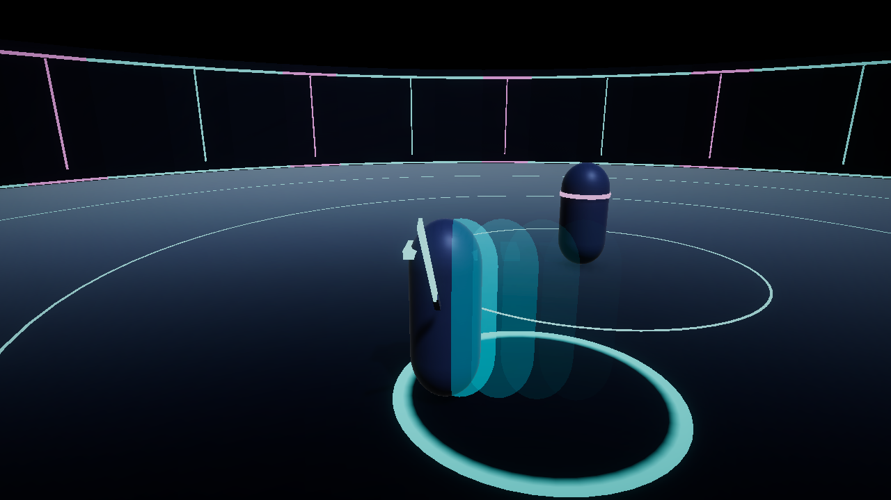
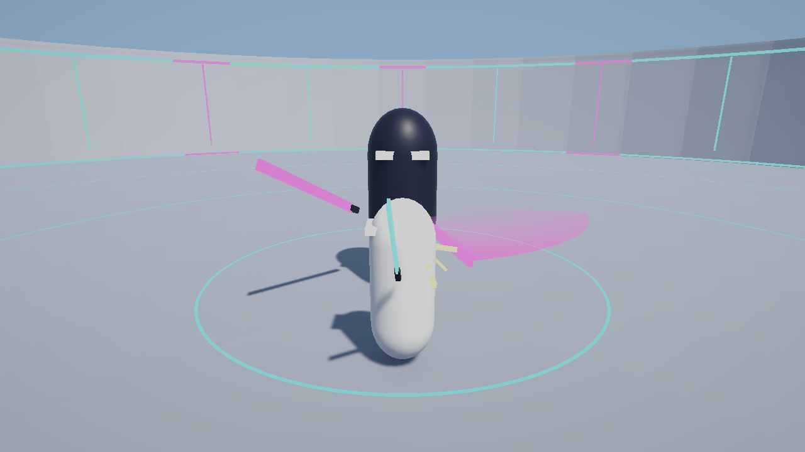
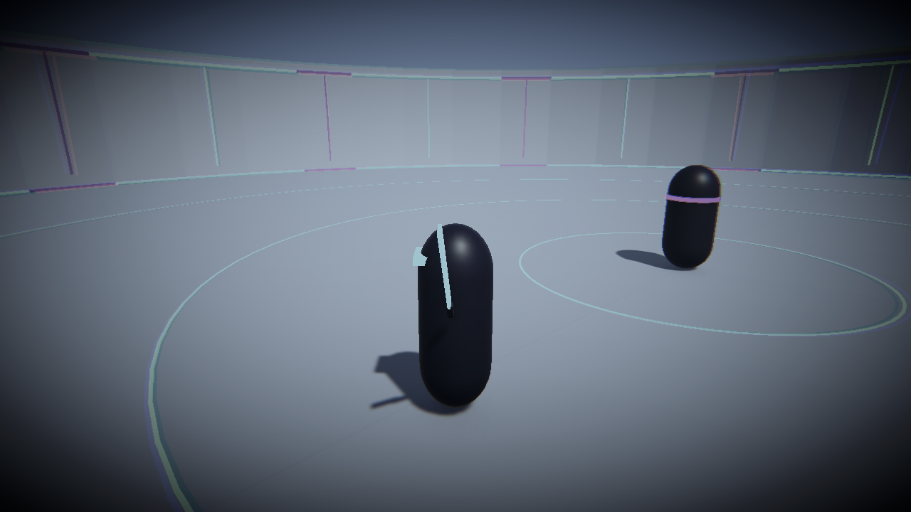
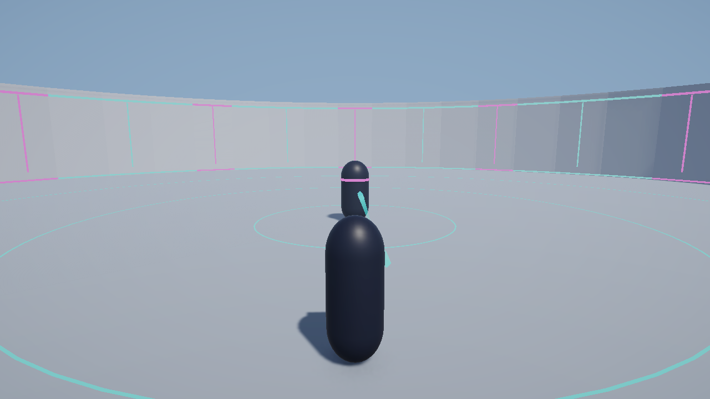
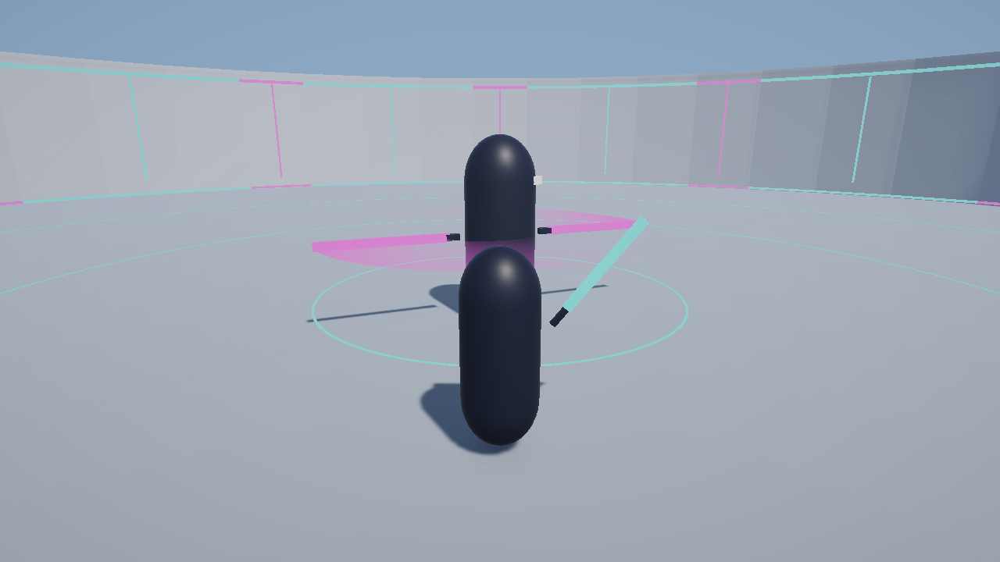
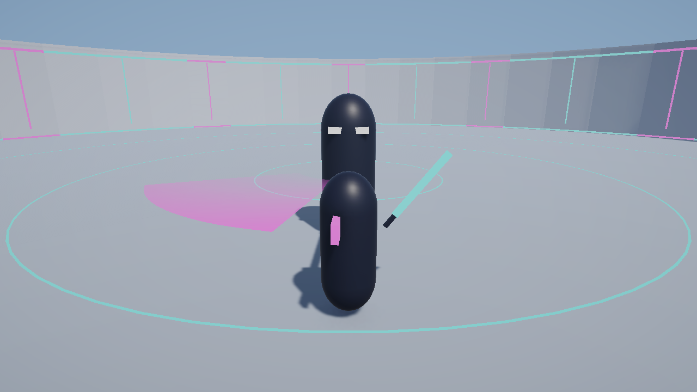
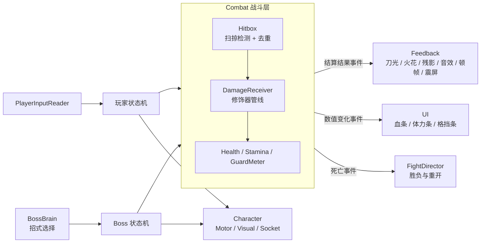

# BossFight3D — 暗影剑客 Boss 战

一个用 Unity 6 制作的第三人称 3D Boss 战 Demo：节奏比类魂游戏更快，规则更简单，反馈更明确。
玩家用轻攻击、蓄力重击、翻滚和"识破"对抗一个持双剑、会瞬移的两阶段 Boss。

当前角色是占位的胶囊体，所有特效和音效都由代码生成，没有使用任何外部美术或音频素材。

<!-- TODO：录制一段 15~30 秒的战斗 GIF，保存为 docs/images/demo.gif，然后把下面两张截图换成它 -->

| 翻滚残影与完美闪避光环 | Boss 的双剑刀光 |
|---|---|
|  |  |

| 慢动作滤镜 | 能量飞镖 |
|---|---|
|  |  |

| Boss 旋风斩 | Boss 长剑形态 |
|---|---|
|  |  |

## 玩法

- **轻攻击三连**：左键，带输入缓冲，后摇可以用翻滚或移动取消。
- **蓄力重击**：按住右键蓄力（持续消耗体力），松开后跃起下劈。
- **切手技**：左右键组合，一记更快的下劈，也可以从轻攻击的后摇派生。
- **识破**：切手技或蓄力重击出手后的 0.2 秒内如果正好被攻击，会化解这次攻击、立即反击，并在 3 秒内不消耗体力。高风险，高回报。
- **翻滚**：带无敌帧；在无敌帧内躲过攻击（完美闪避）返还体力，并且可以马上按左键打出一记突进的闪避反击。
- **慢动作**：按 R 让整个世界（包括自己）变慢，用来看清 Boss 的出手、找准识破和闪避的时机。消耗技能条，完美闪避和识破会补充它。
- **三种武器**（按 F 切换，共用同一套按键）：
  - 剑：三连斩、跃起重击、切手技，攻守均衡。
  - 飞镖：远程投掷，无限使用；蓄力后更快更痛。不能识破。
  - 拳套：左右拳快速连打，蓄力后向前瞬移冲拳。识破窗口更宽，但成功时仍要承受少量伤害。
- **Boss 格挡条**：Boss 不出招时会格挡，硬砍只能磨血。打空格挡条让它破防，破防期间的蓄力重击是伤害最高的一击，带特写镜头。
- **两个阶段**：Boss 血量低于一半后进入二阶段，出招更快。

Boss 的招式：快慢刀三连斩、瞬移到头顶的瞬身斩、贴地飞行的剑气、被连续攻击时的后撤瞬身（可能接一记突进斩）、
旋转着追击并把飞镖弹回来的旋风斩。二阶段在玩家远离时会把双剑合成长剑：攻击距离更远、连招变成三快一慢的四连击、
不会被打断，但也不再格挡。

## 操作

| 按键 | 动作 |
|---|---|
| W A S D | 移动 |
| 鼠标 | 转动视角 |
| 左 Shift | 奔跑 |
| 空格 | 翻滚 |
| C | 跳跃（可以越过贴地的剑气） |
| R | 慢动作（消耗技能条，再按一次结束） |
| F | 切换武器：剑 → 飞镖 → 拳套 |
| 鼠标左键 | 轻攻击 |
| 按住鼠标右键 | 蓄力，松开打出重击 |
| 左键 + 右键 | 切手技 |
| 鼠标中键 | 锁定 / 取消锁定 Boss |
| Esc | 短按释放鼠标；按住 1 秒退出游戏 |

## 运行

**直接玩**：在 [Releases](https://github.com/zyh625/BossFight3D/releases) 下载 Windows 版本，解压后运行 `BossFight3D.exe`。

**从源码运行**：

1. 用 Unity 6000.4（URP）打开工程。
2. 打开场景 `Assets/_Project/Scenes/Arena.unity`，点击 Play。

预制体和场景都由 Editor 脚本生成。如果它们损坏或丢失，执行菜单 `Tools/BossFight/Build All` 即可重建；
`Tools/BossFight/5 Build Windows` 会把可执行文件打到 `Builds/Windows/`。

## 技术要点

- **数据驱动的招式时序**：每一招的前摇、判定、后摇、伤害、体力都在 ScriptableObject 里，由代码计时器驱动；动画只负责外观，换动画不会改变判定。
- **状态机**：玩家和 Boss 各自是一个有限状态机，每个动作或招式是一个独立的状态类。
- **伤害结算管线**：武器判定 → 受击判定 → 一串可插拔的修饰器（无敌帧、识破、格挡条、破防增伤）→ 扣血 → 广播结果。新增一种防御机制不需要改已有代码。
- **扫掠式命中检测**：在上一帧和这一帧的武器位置之间插值检测，快刀不会穿过目标；一刀对同一目标只结算一次。
- **局部顿帧**：命中时只暂停攻击者和受击者各自的时间，不修改全局 `Time.timeScale`。
- **表现与玩法解耦**：刀光、火花、残影、音效、镜头震动都只订阅战斗层的事件，删掉它们游戏照常运行。
- **程序化表现**：刀光是按武器轨迹生成的带状网格（Catmull-Rom 平滑）；残影通过观察位移自动触发；音效用波形合成。
- **可替换的角色模型**：逻辑根物体与模型分离，动画使用 Humanoid 重定向，代码不依赖骨骼名称，武器通过 Socket 挂到骨骼上。
- **自动化测试**：49 条 PlayMode 测试加载真实场景，覆盖玩家输入、招式命中与胜负结算。
- **可重复的搭建**：场景、预制体、材质和动画控制器都由 Editor 脚本一键生成。

## 架构

依赖是单向的：`Core ← Combat ← Player / Boss`，`Feedback`、`UI`、`Game` 只依赖下层，没有任何玩法代码反过来依赖它们。

| 程序集 | 职责 |
|---|---|
| `Core` | 通用状态机 |
| `Combat` | 生命、体力、攻击数据、Hitbox / Hurtbox、伤害结算管线 |
| `Character` | 位移（CharacterController 封装）、模型接口、Socket、局部顿帧 |
| `Player` | 输入、输入缓冲、玩家的各个状态、锁定 |
| `Boss` | Boss 的各个招式状态、招式选择、格挡条、阶段切换 |
| `Feedback` | 刀光、命中特效、残影、音效、受击闪白、镜头震动 |
| `CameraRig` | Cinemachine 轨道相机输入、锁定相机、破防特写 |
| `UI` | HUD 与结算界面 |
| `Game` | 战斗流程 |
| `Editor` | 场景、预制体、材质、动画控制器的生成脚本，以及打包脚本 |

## 文档

每个里程碑都有一份说明：解决什么问题、核心类、设计取舍，以及面试时可能被问到的问题。

| 文档 | 内容 |
|---|---|
| [DESIGN.md](docs/DESIGN.md) | 玩法设计、招式表、数值、架构和里程碑计划 |
| [M1 角色基础](docs/M1_角色基础.md) | 移动、相机、可替换的角色结构 |
| [M2 战斗核心](docs/M2_战斗核心.md) | 状态机、伤害管线、轻重攻击、输入缓冲 |
| [M3 玩家防御与锁定](docs/M3_玩家防御与锁定.md) | 翻滚、识破、锁定、局部顿帧 |
| [M4 Boss 基础](docs/M4_Boss基础.md) | Boss 状态机、三连斩、格挡条与破防 |
| [M5 Boss 技能与二阶段](docs/M5_Boss技能与二阶段.md) | 瞬身斩、剑气、后撤、阶段切换 |
| [M6 战斗界面与流程](docs/M6_战斗界面与流程.md) | HUD、胜负结算、破防特写 |
| [M7 表现打磨](docs/M7_表现打磨.md) | 刀光、命中特效、残影、程序音效 |
| [M8 调优与发布](docs/M8_调优与发布.md) | 构建流程、调试数值与正式数值的隔离 |
| [M9 慢动作与闪避反击](docs/M9_慢动作与闪避反击.md) | 时间缩放下的两套计时、技能条、闪避反击 |
| [M10–M13 P1 内容](docs/M10-M13_P1内容.md) | 旋风斩与后撤突进、飞镖、拳套、Boss 长剑形态 |
| [MODEL_SWAP.md](docs/MODEL_SWAP.md) | 替换角色模型的步骤和 Blender 制作规范 |
| [CREDITS.md](docs/CREDITS.md) | 素材来源与许可证 |

## 环境

Unity 6000.4 · URP · Input System · Cinemachine 3 · C#

## 接下来

- 用自制的角色模型和动画替换占位胶囊体
- 残影分身、完整的转阶段演出、第一人称视角
