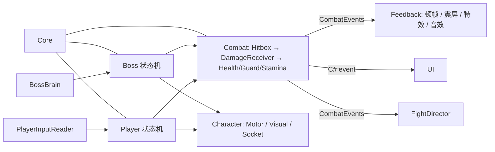

# 暗影剑客 Boss 战 Demo 设计文档

> 状态：v0.3（开发中）。
> v0.3 玩家剑形态采用左键轻击、右键蓄力重击、双键切手技。玩家的防御手段是翻滚和识破。
> 文中所有数值都是初始值，实现时全部放在 ScriptableObject / Inspector 中，靠实测手感再调。
> 标 ❓ 的地方需要你做决定，汇总在第 7 节。

---

## 1. 玩法循环

一场战斗目标时长 **2~3 分钟**，玩家容错约 5~6 次失误。

```
观察 Boss 前摇 ──► 选择应对 ──► 获得进攻窗口 ──► 输出 / 削格挡条 ──► 破防 ──► 破防重击（高光时刻）
                     │
                     ├─ 翻滚（无敌帧）   → 完美闪避：返还体力
                     ├─ 识破（迎着攻击出切手技或重击）→ 化解这次攻击 + 强化反击 + 短时间免体力消耗
                     └─ 走位拉开         → 诱发 Boss 远程技能（瞬身斩 / 剑气）
```

核心张力有两条：

1. **体力**：攻击、翻滚、奔跑都耗体力，重击尤其贵；识破成功则免除消耗——高风险高回报。
2. **Boss 格挡条**：Boss 不出招时会格挡，硬砍只能磨血；真正的伤害来自「Boss 出招后的后摇」和「打空格挡条后的破防」。

所以最优打法是：躲开或识破 Boss 的招式 → 在后摇里输出 → 平时的攻击用来削格挡条 → 破防后蓄力打一发破防重击。

---

## 2. 玩家能力参数（P0，剑形态）

### 2.1 基础属性

| 项目 | 初始值 | 说明 |
|---|---|---|
| 生命 | 100 | |
| 体力 | 100 | |
| 体力恢复 | 静止 30/s，走路 18/s | 任何消耗体力的动作结束后延迟 0.6s 才开始恢复 |
| 走 / 跑速度 | 3.5 / 6.5 m/s | 奔跑消耗 12 体力/s |
| 输入缓冲 | 0.2s | 动作后摇中提前按下的指令会被记住，保证连招手感 |

### 2.2 动作表

| 动作 | 输入 | 体力 | 前摇 / 判定 / 后摇 (s) | 伤害 | 削格挡条 | 备注 |
|---|---|---|---|---|---|---|
| 轻攻击 1 | 左键 | 10 | 0.18 / 0.10 / 0.30 | 18 | 12 | 按下当帧出手；后摇后半段可接下一段 |
| 轻攻击 2 | 左键 | 10 | 0.16 / 0.10 / 0.32 | 18 | 12 | |
| 轻攻击 3 | 左键 | 12 | 0.25 / 0.12 / 0.50 | 26 | 18 | 收招较长 |
| 蓄力 | 按住右键 | 35/s | 满蓄力 1.0 | — | — | 以 35% 移速移动。满蓄后继续扣体力 |
| 蓄力重击 | 松开右键或蓄力耗尽体力 | 出招时 0 | 0.45 / 0.15 / 0.60 | 45~69.75（按蓄力 0~1.0s 插值） | 35 | 耗尽后松开右键才可再次蓄力 |
| 切手技 | 按住右键时按左键，支持双键同帧和轻击后摇派生 | 20 | 0.28 / 0.12 / 0.40 | 32 | 25 | 可从蓄力中切换，独立于蓄力进度 |
| **识破** | 切手技或蓄力重击出手后 0.2s 内受击 | 返还本招实际支付的体力 | 跳过剩余前摇 | 反击伤害 × 1.3 | 反击额外 +25 | 化解一次攻击，接下来 3s 动作免体力 |
| 翻滚 | 空格 | 20 | 全程 0.60，无敌帧 0.05~0.35 | — | — | 位移 4.5m；无敌帧内被判定命中 = 完美闪避，返还 20 体力 |
| 破防重击 | Boss 破防时打出蓄力重击 | 同蓄力重击 | 同蓄力重击 | 重击伤害 × 2.5 | — | 特写镜头 + 0.25s 顿帧 + 强化特效 |
| 锁定 | 鼠标中键 | — | — | — | — | 锁定时移动变为环绕平移，攻击/翻滚以 Boss 为参照 |

翻滚可以脱离攻击范围，并在无敌帧内返还翻滚体力。识破要求玩家迎着敌人的出手启动切手技或蓄力重击，成功后立即反击。详细时序见 7.7。

受击：普通受击硬直 0.4s，可被翻滚取消的时间点在 0.25s 之后（防止被连到死）。

---

## 3. Boss 设计（P0）

### 3.1 基础属性

| 项目 | 初始值 |
|---|---|
| 生命 | 1200 |
| 格挡条 | 100 |
| 格挡时受到的生命伤害 | 原伤害 × 20% |
| 格挡条恢复 | 4s 未被命中后以 10/s 恢复 |
| 体型 | 玩家的 1.5 倍（缩放的是 Visual，碰撞体和招式距离单独配置） |

### 3.2 招式表

时间单位为秒。「可打断」指玩家的重击类攻击能否让 Boss 中断出招。

| 招式 | 触发距离 | 前摇（提示） | 判定 | 后摇 | 伤害 | 可应对方式 | 冷却 |
|---|---|---|---|---|---|---|---|
| **三连斩** 第 1 刀（左剑） | ≤ 3.2m | 0.45 | 0.12 | — | 12 | 翻滚 / 识破 | 1.5 |
| 第 2 刀（右剑） | | 0.35 | 0.12 | — | 12 | 翻滚 / 识破 | |
| 第 3 刀（交叉下劈，慢刀） | | **0.75**（停顿 + 双剑高举发光） | 0.15 | 1.0 | 24 | 翻滚 / 识破 | |
| **瞬身斩** | ≥ 7m | 0.8 原地蓄力（身体收束发光）→ 瞬移到玩家头顶 4m → 滞空 0.4（地面出现落点圈） | 0.2 下劈，落点半径 2.5m | 1.2 | 32 | 落点在滞空开始时锁定，随后滚出圈或识破下劈 | 8 |
| **剑气** | 4~14m | 0.7（剑身拖地蓄光） | 贴地飞行，速度 18m/s，宽 1.6m，射程 14m | 0.8 | 28 → 10（随距离线性衰减） | 横向翻滚 / 识破 | 6 |
| **后撤瞬身** | 被连续攻击时 | 无 | 0.25s 内后撤 5m，带残影拖尾 | 0.3 | — | — | 4 |

**三连斩的快慢刀**是 P0 最重要的"学习点"：前两刀节奏固定，第三刀故意延迟，提前翻滚会被抓。第三刀的后摇 1.0s 是给玩家的主要输出窗口。

### 3.3 格挡条与破防

```
格挡条 > 0  ──被打空──►  破防硬直 3.5s  ──►  虚弱期（格挡条 0→100 恢复中，约 6s）──► 恢复正常
 不出招时自动格挡          受到伤害 × 1.5        不会格挡；出招前摇可被重击打断
 只掉 20% 血 + 掉格挡条     破防重击 × 2.5
```

- 这样把你原设计的「耗尽后韧性降低、更容易被打断」（= 虚弱期）和【建议新增】的「破防硬直」串成了一条线，两者都保留。
- Boss 出招期间承受完整生命伤害，通常有霸体。识破反击仍能削减格挡条，打空时立即破防。虚弱时，蓄力重击和识破反击可打断前摇。

### 3.4 后撤瞬身的触发

基础概率 10%，玩家 2s 内每连续命中一次 +15%，上限 60%，触发后清零。只在 Boss 处于格挡/待机时判定。

### 3.5 二阶段（P0 简化版）

生命 ≤ 50% 时：打断当前动作 → 无敌 2.0s + 能量爆发特效 + 击退周围玩家 → 进入二阶段。
二阶段变化：格挡条回满；所有招式冷却 × 0.65；三连斩前两刀前摇 × 0.85；自发光颜色由青色变为品红色（让"变强了"一眼可见）。

### 3.6 招式选择逻辑

每次回到"决策"状态时：筛掉冷却中和距离不符的招式 → 按权重随机 → 同一招式连续使用时权重减半。没有可用招式时靠近或横移观察。

---

## 4. 系统架构

### 4.1 模块与职责

| 模块（程序集） | 职责 | 核心类 |
|---|---|---|
| **Core** | 与玩法无关的通用设施 | `StateMachine<T>` / `IState`、`GameClock`（时间）、`EventChannel`（SO 事件通道）、`Cooldown` |
| **Combat** | 伤害的产生、结算、广播；玩家和 Boss 共用 | `Health`、`Stamina`、`Hitbox`、`Hurtbox`、`DamageInfo`、`DamageReceiver`（结算管线）、`AttackData`（SO） |
| **Character** | 角色通用外壳，保证模型可换 | `CharacterMotor`（封装 CharacterController）、`CharacterVisual`（Animator 包装）、`SocketBinder`（Socket 挂骨骼）、`LocalHitStop`（顿帧） |
| **Player** | 输入、玩家状态机与玩家防御 | `PlayerInputReader`、`PlayerController`、各状态类（Locomotion / Roll / Attack / Charge / Hit / Dead）、`LockOnTargeting` |
| **Boss** | Boss AI | `BossController`、`BossBrain`（招式选择）、`BossMoveData`（SO，每招一份）、各状态类、`GuardMeter`、`BossPhaseController` |
| **Feedback** | 一切"表现"：只监听事件，不影响玩法 | `HitStop`、`CameraShaker`（Cinemachine Impulse）、`VfxSpawner`（对象池）、`SfxPlayer`、`WeaponTrail`、`AfterImage` |
| **CameraRig** | 相机 | `OrbitCameraInput`（自由 / 锁定共用轨道），后续特写使用 Cinemachine 相机混合 |
| **UI** | HUD 与流程界面 | `BarView`（通用条）、`BossHud`、`PlayerHud`、`ResultScreen` |
| **Game** | 流程 | `FightDirector`（开始 / 胜利 / 失败 / 重开） |
| **Editor** | 自动化搭建 | 场景生成、预制体组装、Animator Controller 生成脚本 |

### 4.2 依赖方向与通信方式



三种通信方式，各管一类问题：

1. **直接引用**（同一物体上的组件之间）：如状态机调用 `CharacterMotor.Move()`。
2. **C# event**（一对多、关心某个具体对象）：`Health.Changed`、`GuardMeter.Broken`。UI 的血条订阅它，Health 不知道 UI 存在。
3. **全局事件通道 `CombatEvents`**（ScriptableObject）：`HitLanded(DamageResult)`、`PerfectParry`、`PerfectDodge`、`GuardBroken`、`PhaseChanged`。Feedback 和 FightDirector 订阅。

**原则：玩法层不引用表现层**。把 Feedback 整个程序集删掉，游戏依然能玩，只是没有特效——这保证了"特效炫酷"的迭代不会碰坏战斗逻辑。

### 4.3 伤害结算管线

```
Hitbox（挂在武器 Socket 上，只在判定帧开启，本次挥砍内对同一目标去重）
   │  用"上一帧 → 这一帧"的胶囊扫掠检测，避免快刀穿过目标
   ▼
Hurtbox（挂在逻辑物体上，不依赖模型网格）
   ▼
DamageReceiver：按顺序询问一串 IDamageModifier
   ① 无敌（翻滚 i-frame / 转阶段）→ Dodged
   ② 识破 → Parried
   ③ Boss 格挡 → Blocked（改写伤害，扣格挡条）
   ④ 破防增伤 → 伤害 × 倍率
   ▼
Health.ApplyDamage → 产出 DamageResult{类型, 最终伤害, 命中点, 攻击者} → 广播
```

玩家的翻滚和识破共用一个修饰器入口，由当前动作状态决定如何处理。Boss 格挡和破防各有自己的结算逻辑。

### 4.4 状态机 vs 行为树 ❓（推荐：状态机）

**推荐：分层状态机 + 数据驱动的招式（ScriptableObject）+ 带权重的招式选择器。**

- 动作游戏的 Boss 本质是"一段时间内只做一件事，且时序严格"（前摇/判定/后摇），这正是状态机擅长的；行为树擅长的是多条件、多优先级的持续决策，这个 Boss 的决策只发生在"选下一招"的一瞬间，用一个权重选择器就够了。
- 一个招式 = 一个状态类 + 一份 `BossMoveData`。加新招式不用改已有代码。
- 面试时能徒手画出来、讲清楚每条转移，比"用了某个行为树插件"更有说服力。
- 代价：招式多了以后转移条件会散落各处。缓解方式是所有招式结束后统一回到 `Decide` 状态，不允许招式之间直接跳转（连段在同一个状态内部处理）。

### 4.5 招式时序：数据驱动，而不是动画事件 ❓（推荐：数据驱动）

前摇/判定/后摇的时间点写在 `AttackData` 里，由状态内的计时器驱动；动画只负责"看起来像"，位移由代码曲线控制（不使用 Root Motion）。

- 好处：换动画、换模型不会丢判定；调手感只改数值；占位动画不贴合时可以用播放速度去对齐数据。
- 代价：动画和判定可能对不上，需要一个调试工具（在 Scene 视图里画出 Hitbox 开启时段）来对齐。这个工具我会在 M2 一起做。
- Animator Controller 用 Editor 脚本生成，只放状态不连转移线，代码里 `CrossFade` 切换——避免手连几十条转移线，也便于我替你维护。

### 4.6 时间系统（为 P1 慢动作提前留好）

| 需求 | 实现 | 是否受慢动作影响 |
|---|---|---|
| 慢动作（P1） | `GameClock` 修改 `Time.timeScale`，同步调整 `fixedDeltaTime` | — |
| 玩法计时（冷却、前后摇、移动、无敌帧、识破窗口） | 一律用缩放后的时间 | 慢动作会延长识破窗口在现实中的持续时间 |
| 顿帧（hitstop） | 攻击者和受击者的 `LocalHitStop` 暂停 Animator 和动作时钟，按真实时间恢复 | 可与慢动作叠加 |
| UI 动画、结算界面、特写镜头混合 | `unscaledDeltaTime` | **不受影响** |
| 音效 | P1 慢动作时降低 pitch | 跟随 |

顿帧不用全局 timeScale 是关键取舍：否则"顿帧恢复时把 timeScale 设回 1"会直接打断正在进行的慢动作。

### 4.7 模型可替换的结构

```
Player（逻辑根：CharacterController、状态机、Hurtbox、所有脚本）
├─ Visual（占位人偶 → 以后换成你的 Blender 模型；Humanoid Animator 在这一层）
├─ Sockets（WeaponR / WeaponL / VfxChest / VfxFoot...，运行时由 SocketBinder 用
│           Animator.GetBoneTransform(HumanBodyBones.RightHand) 挂到骨骼上）
└─ Weapon_Sword（武器模型 + Hitbox，挂在 WeaponR Socket 下）
```

代码中不出现任何骨骼名或层级路径字符串。详细规范在 M1 完成时写入 `docs/MODEL_SWAP.md`。

---

## 5. 工作量与动画依赖评估

工作量：S ≈ 半天内，M ≈ 1~2 天，L ≈ 3 天以上（指我实现 + 你在编辑器里操作和测试的总量）。
动画来源均为 Mixamo（需要你登录下载，我会在对应里程碑给出具体的动画名清单；以下可用性是我的判断，需要到站内确认）。

### 5.1 P0

| 条目 | 工作量 | 动画依赖 | 说明 |
|---|---|---|---|
| 玩家移动 / 奔跑 / 锁定平移 | M | 低：基础移动 + 8 方向平移，Mixamo 很全 | |
| 翻滚 + 完美闪避 | S | 低：翻滚动画现成 | |
| 轻攻击三连 / 切手技 / 蓄力重击 | M | 低：切手技暂复用重击动画 | |
| 识破 | M | 复用当前招式的挥击段 | |
| 破防重击【建议新增】 | S | 无：复用重击动画 | 只是倍率 + 镜头 + 特效，性价比极高 |
| Boss 三连斩 | M | **中**：Mixamo 双持动画很少 | 方案：单手挥砍 + Humanoid 的 **Mirror** 选项得到左手版本；第三刀用双手大剑下劈，视觉上就是双剑同时劈下 |
| Boss 瞬身斩 | M | 低：蓄力姿势 + 下劈；瞬移和滞空由代码控制位置 | 瞬移本身不需要动画，这是这个设计讨巧的地方 |
| Boss 剑气 | M | 低：任意挥砍 | 剑气用程序化网格 + Shader |
| Boss 格挡条 / 格挡 / 破防【建议新增】 | M | 低：格挡 + 眩晕动画现成 | |
| Boss 后撤瞬身 | S | 低：消失 + 残影拖尾，几乎不靠动画 | |
| 二阶段（简版） | S | 低：一个怒吼/蓄力动画 | |
| 打击感（顿帧 / 震屏 / 火花 / 音效） | M | 无 | |
| 特效（刀光、残影、剑气、闪光） | **L** | 无 | 全部程序化。门面所在，会单独占一个里程碑 |
| UI | M | 无 | |
| 场地 | S | 无 | ProBuilder + 自发光材质，用 Editor 脚本生成 |

**结论：P0 没有动画上的硬阻碍**，唯一的折中是 Boss 的双持动作靠"镜像 + 双手剑动画"拼出来，观感不如专门的双刀动画，但你换成自己的模型后可以再补。

### 5.2 P1

| 条目 | 工作量 | 动画依赖 | 评估 |
|---|---|---|---|
| 慢动作 + 特殊技能条 | S | 无 | 架构已预留，很便宜，效果好 |
| 闪避反击【建议新增】 | S | 低：一个突进刺击 | 值得做 |
| 后撤突进【建议新增】 | S | 低：复用挥砍 + 代码位移 | 值得做 |
| 旋风斩 | M | 中：旋转攻击有现成的，也可以代码转 Visual | |
| 飞镖形态 | M | 低：投掷动画现成 | 需要屏幕中心瞄准，锁定逻辑要适配 |
| 拳头形态 | M~L | 低：拳击动画很多 | 是一整套新动作，工作量主要在调手感 |
| 二阶段长剑形态 + 四连击 | **L** | **高**：等于给 Boss 再做一套动作 | P1 里最重的一项 |

### 5.3 P2

| 条目 | 工作量 | 动画依赖 | 评估 |
|---|---|---|---|
| 残影系统 | M~L | 无 | 架构上招式已是"数据 + 执行器"，残影可以复用执行器，但要让招式不依赖 BossBrain |
| 转阶段演出（15s） | **L** | 中 | 是一个独立的小玩法（弹幕躲避），规则和战斗主体不同 |
| 缴械 | **L** | **很高**：双人配合的强制动画没有现成素材 | 见风险 6.3 |
| 第一人称 | M | 中 | 见风险 6.4 |

---

## 6. 范围与风险

### 6.1 最大的风险是范围，不是技术

完整的 P0+P1+P2 相当于：1 个三武器玩家 + 1 个两形态 Boss + 残影系统 + 一段弹幕演出。对简历 demo 来说，**一个打磨到位的 P0 比一个粗糙的 P0+P1+P2 有价值得多**——面试官通常只看 30 秒 GIF，然后问你某个系统怎么设计的。
我的建议是把 P0 当作唯一的硬目标，P1 里优先做便宜且出效果的（慢动作、闪避反击、后撤突进、旋风斩），再决定要不要做三武器和长剑形态。

### 6.2 P0 内部：特效的工作量容易被低估

"特效要炫酷"是门面，但每个特效都要反复调。我把它单独放在 M7，并且从 M3 起每个里程碑都先放最简版本（白色闪光、默认粒子），避免前面的里程碑被美术细节拖住。

### 6.3 缴械（P2）建议最后做，或者简化 ❓

双方配合的强制动画没有现成素材，程序化做出来容易显得僵硬。简化方案：不做"打飞"的配合动画，改为第四击命中时剑直接以抛物线飞出并插地（纯代码），玩家只播一个受击动画。等 P2 时再定。

### 6.4 第一人称（P2）与近战的冲突

第三人称的近战动画在第一人称下通常很难看（手臂穿过镜头、看不清 Boss 上空的瞬身斩）。做的话需要单独的手臂处理。等 P2 时再评估。

### 6.5 三种武器（P1）= 三套动作

每种武器都要有自己的攻击、蓄力、识破规则和动画。建议 P1 内的顺序为飞镖（规则差异大、能配合旋风斩反弹），再到拳头。

### 6.6 我不能操作 Unity 编辑器

场景、预制体、Animator Controller 我都会尽量写成 Editor 菜单命令（`Tools/BossFight/...`）一键生成，你只需要点菜单和拖少量引用。但动画导入（Mixamo 下载、设置 Humanoid）必须你手动做，我会给清单。
另外我看不到运行画面，**手感和视觉效果只能靠你的反馈来迭代**，所以每个里程碑的"应该看到什么"我会写得尽量具体。

### 6.7 Mixamo 素材与公开 GitHub 仓库 ❓

Mixamo 的角色和动画可以免费用于商业项目并随游戏发布，但其条款不允许把原始素材文件单独再分发。把 FBX 提交到**公开仓库**属于灰色地带。选项见 7.5。

### 6.8 当前目录还不是 Unity 工程

目前文件夹里只有 `BossFight.md`，没有 Unity 工程，也没有 git 仓库。M1 的第一步是由你用 Unity Hub 创建 URP 工程，具体步骤我会在 M1 开始时给出。

---

## 7. 需要你决定的问题

### 7.1 旋风斩反弹的飞镖（P1）

| 选项 | 效果 | 评价 |
|---|---|---|
| **A. 飞回玩家（推荐）** | 反弹的飞镖变成 Boss 的攻击，玩家可以翻滚或识破 | 规则清晰（"旋风时别扔飞镖"），还能和识破形成互动，实现也最简单 |
| B. 随机方向弹开 | 只是让飞镖失效 | 没有惩罚也没有互动，玩家感知弱 |
| C. 飞回玩家但带随机偏移 | 介于两者之间 | 结果有运气成分，不够"明确" |

### 7.2 动画素材的取舍

见第 5 节。需要你确认的只有一点：**P0 的 Boss 双持动作用"单手挥砍镜像 + 双手剑下劈"拼出来，接受吗？** 备选是把 Boss 的前两刀设计改成"同一只手的正反手两刀"，动画更自然但失去"左右剑各一次"的特征。我推荐前者。

### 7.3 【建议新增】的四项

| 条目 | 建议 | 理由 |
|---|---|---|
| 破防（P0） | **做** | 没有它，格挡条只是"第二条血"；有了它才有节奏起伏。成本低 |
| 破防重击（P0） | **做** | 全 demo 最适合做 GIF 的瞬间，成本只是倍率 + 镜头 + 特效 |
| 后撤突进（P1） | **做** | 成本很低（复用现有状态），让 Boss 的后撤有威胁 |
| 闪避反击（P1） | **做，但排在慢动作之后** | 和识破反击对称，让闪避流也有收益 |

四项我都建议保留，没有需要去掉的。

### 7.4 架构上的两个选择

- 4.4：Boss AI 用状态机（推荐）还是行为树？
- 4.5：招式时序用数据驱动（推荐）还是动画事件？

### 7.5 Mixamo 素材怎么进仓库

| 选项 | 说明 |
|---|---|
| **A. 不提交 Mixamo 原始文件（推荐）** | `.gitignore` 忽略该目录，在 CREDITS.md 里列出需要下载的角色和动画清单；Windows 构建版本放在 GitHub Release 里（构建里包含素材是允许的） |
| B. 直接提交 | 最省事，克隆即可运行，但有条款风险 |
| C. 仓库设为私有，只公开 README + 构建 + 视频 | 最稳妥，但面试官看不到代码 |

### 7.6 战斗难度基调

| 选项 | 说明 |
|---|---|
| **A. 偏简单（推荐）** | 即本文档的数值：玩家可以失误 5~6 次，前摇都在 0.35s 以上。面试官很可能只玩一次，要让他能打到二阶段、看到破防重击 |
| B. 类魂标准 | 玩家只能失误 3~4 次，前摇缩短约 20% |

### 7.7 识破时序

- 从招式实际开始时计时。切手技等到轻击衔接点才开始计时，蓄力重击等到松键或体力耗尽才开始计时。
- 在出手后 `[0, 0.2s)` 内第一次受击时，化解这次伤害，跳过当前招式剩余前摇，并将该招伤害乘以 1.3、削格挡值加 25。蓄力进度只决定重击的基础伤害。
- 切手技返还自身实际支付的体力。蓄力重击返还本轮蓄力消耗。接下来 3 秒免除体力消耗，包括奔跑、翻滚、攻击和蓄力。

---

## 8. 开发里程碑（P0，共 8 个）

每个里程碑结束时都可以运行并看到效果；结束时附带：编辑器操作步骤、测试方法、`docs/` 下的系统说明（含 3 个面试问答）。你测试通过后提交 git 再进入下一个。

| # | 里程碑 | 内容 | 结束时能看到 |
|---|---|---|---|
| **M1** | 工程与角色基础 | 工程/包/目录/程序集；输入；`CharacterMotor`；逻辑根与 Visual 分离、Socket；移动、奔跑；Cinemachine 自由视角；Editor 脚本生成灰盒场地。文档：`MODEL_SWAP.md`、`CREDITS.md` | 占位人偶在场地里走、跑，相机跟随 |
| **M2** | 战斗核心 | 通用状态机；`Health`/`Stamina`/`Hitbox`/`Hurtbox`/伤害管线；轻攻击三连、蓄力重击、输入缓冲；训练木桩；Hitbox 调试可视化 | 砍木桩掉血，体力消耗与恢复正确 |
| **M3** | 玩家防御与锁定 | 玩家生命与受击；翻滚（无敌帧、完美闪避）；识破；锁定相机；一个会定时出拳的测试木桩；最简版顿帧和震屏 | 能锁定测试木桩、环绕移动并练习识破和完美闪避。见 [M3 试玩步骤](M3_玩家防御与锁定.md) |
| **M4** | Boss 基础 | Boss 状态机、`BossBrain`、追击；三连斩；格挡条、格挡、破防、虚弱期；受击与死亡 | 可以和只会三连斩的 Boss 打一场完整的战斗。见 [M4 试玩步骤](M4_Boss基础.md) |
| **M5** | Boss 技能与二阶段 | 瞬身斩、剑气、后撤瞬身；招式选择器；二阶段简版 | Boss 招式齐全，战斗有两个阶段。见 [M5 试玩步骤](M5_Boss技能与二阶段.md) |
| **M6** | UI 与流程 | Boss 血条/格挡条、玩家血条/体力条/技能条（占位）；胜利/失败/重开；破防重击特写镜头 | 从开始到结算的完整一局，可重开 |
| **M7** | 表现打磨 | 刀光拖尾、瞬移残影、剑气、火花、识破和完美闪避闪光；Bloom 与后处理；场地美术；音效；顿帧和震屏调参 | 达到"可以录 GIF"的观感 |
| **M8** | 调优与发布 | 数值和手感调整；Windows 构建；README（GIF、架构图、操作说明） | **可投递版本** |

P0 完成后的顺序（届时再细化）：
M9 慢动作 + 闪避反击 → M10 旋风斩 + 后撤突进 → M11 飞镖 → M12 拳头 → M13 长剑形态 → P2（残影 → 转阶段演出 → 第一人称 → 缴械）。
